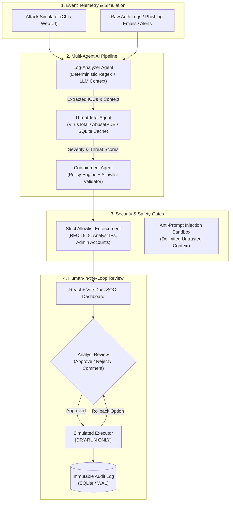

# AutoSOC Sentinel 🛡️
> **Autonomous Incident Response System with Human-in-the-Loop Approval**

[](https://fastapi.tiangolo.com)
[](https://react.dev)
[](https://tailwindcss.com)
[](https://docs.pytest.org)
[](#safety--quality-guarantees)

---

## 1. Project Overview

When a simulated phishing email, brute-force authentication spike, or suspicious endpoint alert arrives, **AutoSOC Sentinel** coordinates a sequential pipeline of AI agents that extracts indicators of compromise (IOCs), enriches them with multi-source threat intelligence, calculates risk severity, and drafts containment actions.

A human SOC analyst reviews proposed containment actions in a dark SOC-themed dashboard, approving or rejecting each item with one click (or using **"Approve All Recommended"**). 

> **Important Safety Guarantee:** Nothing is ever executed against real production infrastructure. All containment actions are safely handled by a dedicated simulator engine that logs dry-run commands and maintains an immutable audit trail with full rollback capabilities.

---

## 2. Multi-Agent Architecture



### Agent Responsibilities & Safeguards

| Agent | Module | Input & Output | Key Safeguards |
|---|---|---|---|
| **1. Log-Analyzer Agent** | `backend/app/agents/log_analyzer.py` | **In:** Raw email / auth syslog<br/>**Out:** Typed IOCs, summary, incident classification | • Deterministic regex extraction before LLM.<br/>• Refangs defanged indicators (`hxxp://`, `1[.]1[.]1[.]1`).<br/>• Sandboxes untrusted input inside `<<<UNTRUSTED_EVENT_CONTENT>>>` tags to prevent prompt injection. |
| **2. Threat-Intel Agent** | `backend/app/agents/threat_intel.py` | **In:** Extracted IOC list<br/>**Out:** 0–100 threat reputation scores, overall severity, confidence | • SQLite TTL caching (24-hour expiration).<br/>• Multi-source integration (VirusTotal v3, AbuseIPDB v2).<br/>• First-class Mock Mode providing realistic reputation data without requiring external API keys. |
| **3. Containment Agent** | `backend/app/agents/containment.py` | **In:** Enriched incident telemetry<br/>**Out:** Drafted containment actions with rollback scripts | • Generates concrete commands (`iptables`, `ufw`, AWS SG CLI, DNS RPZ sinkhole, Active Directory PowerShell).<br/>• **Deterministic Allowlist Enforcement:** strictly blocks firewalling or locking RFC 1918 private subnets, loopbacks, analyst workstation IPs, and admin service accounts. |

---

## 3. Tech Stack

- **Backend:** Python 3.11+, FastAPI, Pydantic v2, SQLAlchemy 2.0 (with SQLite WAL mode & foreign key pragma)
- **Agent Orchestration:** Custom typed sequential pipeline with `BaseAgent[InputT, OutputT]` generic ABC and automated step timing
- **LLM Layer:** Pluggable `LLMProvider` interface with Google Gemini (`gemini-2.0-flash` via `google-genai` SDK) and an offline deterministic `MockLLMProvider`
- **Frontend:** React 18, Vite, TypeScript, Tailwind CSS, Lucide React icons
- **Real-Time Communication:** Full-duplex WebSocket stream (`/ws/events`) with automatic heartbeat and reconnection handling
- **Configuration & Security:** `pydantic-settings` reading from `.env` with strict allowlist CIDR validation
- **Testing:** `pytest`, `pytest-asyncio`, `httpx` (56 automated tests)
- **Containerization:** Docker & Docker Compose (FastAPI backend + Nginx frontend reverse proxy)

---

## 4. Key Features

- **Live Incident Queue:** Real-time WebSocket incident queue with severity color-coding (`Critical`, `High`, `Medium`, `Low`), status indicators, and quick filters.
- **Human-in-the-Loop Review Panel:**
  - Per-action **Approve (Simulated)** and **Reject** buttons with optional analyst comment field.
  - **"Approve All Recommended"** batch button for instant SOC response.
  - One-click **Rollback** for any executed action.
  - Syntax-highlighted dry-run rule commands and rollback commands preview.
- **Threat Intelligence & IOCs Table:** Displays indicator type, value, context, normalized threat reputation meter (0–100), and source badge.
- **AI Agent Reasoning Timeline:** Transparent step-by-step audit showing duration (ms), inputs, outputs, and reasoning from each agent.
- **Operational Metrics Banner:** Real-time counters for Incidents Today, Open Incidents, Mean Time to Respond (MTTR), and Action Approval Rate.
- **Interactive Attack Simulator:** Ingest realistic attacks via CLI or through the UI dropdown (Credential Harvesting, CEO Wire Fraud, Malware Attachment, Brute-Force, Impossible Travel, and Benign False-Positive Tests).

---

## 5. Setup & Run Instructions

### Prerequisites
- Python 3.10+
- Node.js 18+ and npm
- (Optional) Docker and Docker Compose

### 1. Clone & Configure Environment

```bash
git clone https://github.com/Anshbhardwajcseds1/autosoc-sentinel.git
cd autosoc-sentinel

# Copy environment configuration
cp .env.example .env
cp .env.example backend/.env
```
*(By default `MOCK_MODE=true` and `LLM_MOCK_MODE=true`, so the entire application runs offline with zero external API keys required.)*

### 2. Backend Setup & Startup

```bash
cd backend
pip install -r requirements.txt
python -m uvicorn app.main:app --host 0.0.0.0 --port 8000 --reload
```
- API Base URL: `http://localhost:8000`
- Interactive OpenAPI Docs: `http://localhost:8000/docs`
- Health check: `http://localhost:8000/health`

### 3. Frontend Setup & Startup

Open a second terminal window:

```bash
cd frontend
npm install
npm run dev
```
- Web Dashboard: `http://localhost:5173`

---

## 6. Running Tests

Run the full automated test suite covering regex extraction, allowlists, mock threat intel, simulated executor, rollbacks, and end-to-end API workflows:

```bash
cd backend
python -m pytest tests/ -v
```

```text
tests/test_containment.py: 6 passed (allowlist, rules, rollbacks)
tests/test_log_analyzer.py: 8 passed (regex, refang, LLM prompt injection)
tests/test_phase1.py: 31 passed (models, schemas, database, simulator)
tests/test_pipeline_e2e.py: 3 passed (simulate, approve, rollback, batch, audit)
tests/test_threat_intel.py: 8 passed (intel scoring, caching, mock mode)
======================== 56 passed in 1.47s ========================
```

---

## 7. Simulating Attacks via CLI

AutoSOC Sentinel comes with a dedicated CLI generator for security events:

```bash
# List all 12 available attack scenarios:
python -m simulator.cli --list-scenarios

# Generate and print a credential-harvesting phishing email:
python -m simulator.cli --type phishing_email --scenario credential_phishing --pretty

# Submit an impossible travel auth log directly to the running backend API:
python -m simulator.cli --submit --type auth_log --scenario impossible_travel

# Submit a brute-force attack to the backend API:
python -m simulator.cli --submit --type auth_log --scenario brute_force

# Submit 5 random simulated attacks in a batch:
python -m simulator.cli --submit --type random --count 5
```

You can also click **"Simulate Random Attack"** or pick a scenario from the **"Scenario"** menu in the top navigation bar of the web dashboard.

---

## 8. Running with Docker Compose

To run the entire system inside containers:

```bash
docker-compose up --build
```
- Dashboard: `http://localhost:5173`
- API & Docs: `http://localhost:8000/docs`

---

## 9. Safety & Quality Guarantees

1. **Dry-Run Simulation Only:** The executor never communicates with external firewalls, AWS APIs, or Active Directory instances. All output is strictly logged as simulated commands.
2. **Deterministic Allowlist Enforcement:** Hard-coded rule filters prevent any blocking of RFC 1918 private subnets, loopback addresses, or configured analyst workstation IPs.
3. **Prompt Injection Defense:** Untrusted telemetry is isolated with delimiters (`<<<UNTRUSTED_EVENT_CONTENT>>>`) and system instructions command the model to ignore any instructions found within the input.
4. **Append-Only Audit Log:** Every agent step, analyst approval/rejection, and simulated action is timestamped and written to an immutable SQLite audit log table.

---

## 10. Project Directory Layout

```
autosoc-sentinel/
├── backend/
│   ├── app/
│   │   ├── agents/
│   │   │   ├── base.py                 # Typed BaseAgent ABC
│   │   │   ├── log_analyzer.py         # Regex + LLM extraction
│   │   │   ├── threat_intel.py         # Threat intelligence & scoring
│   │   │   └── containment.py          # Rule engine + allowlist enforcement
│   │   ├── api/
│   │   │   ├── events.py               # POST /api/events, POST /api/simulate
│   │   │   ├── incidents.py            # GET /api/incidents, details, audit
│   │   │   ├── actions.py              # Approve, reject, rollback endpoints
│   │   │   ├── stats.py                # Dashboard metrics & MTTR
│   │   │   └── websocket.py            # Real-time WebSocket event broadcaster
│   │   ├── models/
│   │   │   ├── db_models.py            # SQLAlchemy ORM models
│   │   │   └── schemas.py              # Pydantic v2 schemas
│   │   ├── services/
│   │   │   ├── llm_service.py          # Gemini & Mock LLM providers
│   │   │   ├── threat_intel_service.py # VT, AbuseIPDB, caching
│   │   │   ├── executor.py             # Simulated containment executor
│   │   │   └── audit.py                # Immutable audit log service
│   │   ├── config.py                   # Pydantic settings & allowlists
│   │   ├── database.py                 # SQLite WAL engine & sessionmaker
│   │   ├── orchestrator.py             # Multi-agent sequential pipeline
│   │   └── main.py                     # FastAPI app entry point
│   ├── tests/                          # 56 unit and integration tests
│   ├── Dockerfile
│   └── requirements.txt
├── frontend/
│   ├── src/
│   │   ├── components/
│   │   │   ├── Navbar.tsx              # SOC header & attack simulator menu
│   │   │   ├── StatsBanner.tsx         # Dashboard metrics banner
│   │   │   ├── IncidentQueue.tsx       # Live incident queue
│   │   │   └── IncidentDetail.tsx      # HITL containment review & tabs
│   │   ├── App.tsx                     # Main layout & WS client
│   │   ├── types.ts                    # TypeScript definitions
│   │   └── index.css                   # Tailwind styles
│   ├── package.json
│   ├── vite.config.ts
│   ├── tailwind.config.js
│   ├── nginx.conf
│   └── Dockerfile
├── simulator/
│   ├── generator.py                    # 12 malicious & benign event scenarios
│   ├── cli.py                          # CLI runner with --submit support
│   └── __main__.py
├── docker-compose.yml
├── .env.example
├── .gitignore
└── README.md
```

---

## 11. Limitations & Production Roadmap

- **Prototype Isolation:** Designed for SOC analysts reviewing events locally; production deployment would incorporate multi-analyst RBAC and SAML/OAuth authentication.
- **Database Engine:** Uses SQLite in WAL mode for zero-configuration local evaluation. Production deployment should target PostgreSQL.
- **Simulation Layer:** All containment actions are mock executions by design. Production containment would integrate certified connectors (e.g., Palo Alto Panorama, CrowdStrike Real Time Response, Microsoft Graph API).
